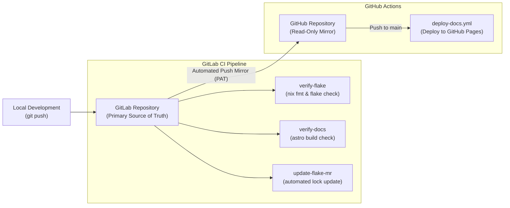

If you are browsing this repository and want to adopt or fork this configuration for your own machines, **do not run `install.sh` against the existing host profiles directly**.

The existing host profiles (`framework16`, `mini-pc-k8`) reference persistent hardware drive IDs (`/dev/disk/by-id/...`), custom NAS network mounts, and private cryptographic keys to decrypt `secrets/*.age`. Attempting to build or install them on other machines will fail with decryption or missing drive errors.

---

## 1. Why Fork First?

Before cloning or bootstrapping, **fork this repository to your own GitLab or GitHub account**.

Forking first ensures that [`post-install.sh`](/post-installation/) can seamlessly complete post-installation onboarding:
1. **Dynamic SSH Remote:** Automatically rebinds your git remote origin from HTTPS to SSH (`git@<forge>:<your-username>/nix-config.git`).
2. **Key Enrollment:** Authenticates with your personal GitHub or GitLab account (`gh` / `glab`) and uploads your new machine's user SSH public key.
3. **Automated Push:** Commits and pushes your machine's probed hardware configuration (`hosts/<hostname>/hardware-configuration.nix`) and host public keys directly back to your own repository without permission errors.

---

## 2. Automated Adoption (`adopt.sh`)

An automated adoption script ([`adopt.sh`](https://gitlab.com/kylekwong/nix-config/-/blob/main/adopt.sh)) is provided at the repository root to sanitize the codebase and bootstrap your machine profile in a single command.

```bash
# 1. Clone YOUR fork of the repository (GitHub or GitLab):
git clone https://github.com/<your-username>/nix-config.git  # or https://gitlab.com/<your-username>/nix-config.git
cd nix-config

# 2. Run adopt.sh to sanitize the repository and scaffold your machine:
./adopt.sh <your-hostname> <your-username> [--laptop | --desktop] [--luks]

# 3. Verify or edit your drive ID in hosts/<your-hostname>/disko.nix:
#    device = "/dev/disk/by-id/..." (discover via: ls -l /dev/disk/by-id/)

# 4. Commit and push your adopted setup back to your fork:
git add .
git commit -m "feat: adopt configuration for <your-hostname>"
git push origin main
```

### Script CLI Options

| Flag | Description |
| :--- | :--- |
| `<hostname>` | **Required**. Target machine hostname (e.g. `workstation`, `thinkpad`). |
| `<username>` | **Required**. Primary user account name (e.g. `alice`). |
| `--laptop` | Enables portable device modules (power management, sleep hooks). |
| `--desktop` | Enables desktop workstation modules (*default*). |
| `--luks` | Configures LUKS disk encryption with TPM2 auto-unlock in `disko.nix`. |
| `--disk <path>` | Pre-configures persistent drive device path in `disko.nix`. |
| `--remote <url>` | Sets the git remote `origin` to your fork repository URL. |
| `--keep-reference` | Preserves the author's host configs under `hosts/_reference/` for reference. |

### What `adopt.sh` Automates

1. **Purges Inaccessible Secrets**: Removes all `secrets/*.age` and empties `modules/secrets/default.nix` (`age.secrets = {};`), preventing Agenix evaluation errors.
2. **Removes Private Network Shares**: Deletes personal SMB NAS modules (`networkshare.nix`) and unlinks them from `modules/desktop` and `modules/laptop`.
3. **Sanitizes AI Providers**: Removes personal Cloudflare Workers AI credentials from `home/cli/opencode.nix` while keeping local Ollama intact.
4. **Scaffolds Target Host**: Removes existing host directories and generates `hosts/<your-hostname>/` containing `default.nix`, `disko.nix` (encrypted LUKS or unencrypted Btrfs), and a stub `hardware-configuration.nix`.
5. **Registers Host in `outputs.nix`**: Updates the `hosts` set with `<your-hostname>` and `<your-username>` importing the chosen form factor module and commented hardware tuning templates.

> [!NOTE]
> `adopt.sh` uses standard POSIX/Bash tools and does not require Nix. It can be run on any existing Linux, macOS, or WSL system prior to flashing installation media. All generated files are pre-formatted to repository code style standards.

---

## 3. Hardware Tuning with `nixos-hardware`

Hardware configurations benefit from vendor-tested kernel parameters, microcode updates, and power profiles provided by [NixOS/nixos-hardware](https://github.com/NixOS/nixos-hardware).

### Finding an OEM Device Profile
Browse the `nixos-hardware` repository. Directory paths map directly to flake module attributes by replacing slashes `/` with hyphens `-`:
- Directory `framework/16-7040-amd/` → `inputs.nixos-hardware.nixosModules.framework-16-7040-amd`
- Directory `lenovo/thinkpad/t14/amd/gen3/` → `inputs.nixos-hardware.nixosModules.lenovo-thinkpad-t14-amd-gen3`
- Directory `dell/xps/15-9500/` → `inputs.nixos-hardware.nixosModules.dell-xps-15-9500`

Add the module attribute directly to `extraModules` in [`outputs.nix`](/architecture/#flake-architecture--repository-layout).

### What to Include If There Is No Device Profile
If your machine is a custom desktop, a mini PC (such as the GMKtec NucBox K8 Plus in this fleet), or an unlisted laptop, compose the appropriate generic component modules under `extraModules` in [`outputs.nix`](/architecture/#flake-architecture--repository-layout):

- **Processor (CPU)**:
  - AMD:
    ```nix
    inputs.nixos-hardware.nixosModules.common-cpu-amd
    inputs.nixos-hardware.nixosModules.common-cpu-amd-pstate # Recommended for Ryzen Zen 2+
    ```
  - Intel:
    ```nix
    inputs.nixos-hardware.nixosModules.common-cpu-intel
    inputs.nixos-hardware.nixosModules.common-cpu-intel-pstate
    ```
- **Graphics (GPU)**:
  - AMD: `inputs.nixos-hardware.nixosModules.common-gpu-amd`
  - Intel: `inputs.nixos-hardware.nixosModules.common-gpu-intel`
  - Nvidia: `inputs.nixos-hardware.nixosModules.common-gpu-nvidia`
- **Storage & Form Factor**:
  - Desktop with NVMe / SATA SSD: `inputs.nixos-hardware.nixosModules.common-pc-ssd`
  - Laptop with NVMe / SATA SSD: `inputs.nixos-hardware.nixosModules.common-pc-laptop-ssd`

### Operating Without `nixos-hardware`
Configuring `nixos-hardware` modules is optional. Even if omitted, `install.sh` automatically probes your system hardware and generates a fully bootable kernel and driver configuration in `hosts/<your-hostname>/hardware-configuration.nix`.

---

## 4. Modules with Secret References

Even after `adopt.sh` clears system-level secrets, one user-space module references a runtime secret file:

| Module | Runtime Secret Path | Impact & Recommended Action |
| :--- | :--- | :--- |
| [`home/cli/atuin.nix`](/home-manager/#cli-and-terminal-utilities) | `/run/agenix/atuin-credentials` | `atuin-auto-login` is skipped cleanly. Authenticate manually via `atuin login` or create your own secret with `agenix -e atuin-credentials.age`. |

---

## 5. Continuous Integration & The Split CI Architecture

This repository uses a **split CI architecture** by design:
- **GitLab CI ([`.gitlab-ci.yml`](https://gitlab.com/kylekwong/nix-config/-/blob/main/.gitlab-ci.yml))**: Serves as the primary, authoritative CI engine for the fleet. It runs system-level flake validations (`nix flake check`), tree formatting enforcement (`nix fmt`), documentation build verification, and automated `flake.lock` update bots with merge request creation.
- **GitHub Actions ([`.github/workflows/deploy-docs.yml`](https://gitlab.com/kylekwong/nix-config/-/blob/main/.github/workflows/deploy-docs.yml))**: Restricted strictly to building and deploying the documentation site to GitHub Pages. GitHub acts as a read-only push mirror.

> [!NOTE]
> The primary motivation for this dual-forge design is **uninterrupted merge availability**: GitHub Actions frequently experiences outages and degraded runner queues that block PR merges when branch protections require CI checks to pass. Running core evaluations on GitLab CI ensures fleet merges are never blocked by GitHub downtime, while GitHub Actions is used strictly for non-critical wiki deployment. See [Split CI Architecture](/split-ci/) for the detailed breakdown.



### Reproducing the Split CI Setup (GitLab Primary + GitHub Read-Only Mirror)

If you want to maintain this setup—keeping the reliability of GitLab CI for system checks while leveraging GitHub Pages for free static wiki hosting—follow these steps:

#### Step 1: Create Repositories on Both Forges
1. Create your main private or public repository on **GitLab** (e.g. `gitlab.com/<username>/nix-config`).
2. Create an empty repository with the same name on **GitHub** (e.g. `github.com/<username>/nix-config`). Do not initialize it with a README or license.

#### Step 2: Generate a GitHub Fine-Grained Personal Access Token (PAT)
GitLab needs write permissions to push branches and tags to your GitHub repository. Using a **fine-grained personal access token** is recommended for long-lived credentials because it follows the principle of least privilege, restricting access solely to the mirror repository:
1. On GitHub, navigate to **Settings** → **Developer Settings** → **Personal Access Tokens** → **Fine-grained tokens**.
2. Click **Generate new token**.
3. **Token name**: `GitLab Mirror Push`.
4. **Expiration**: Select your preferred duration (e.g. 1 year or custom date).
5. **Repository access**: Select **Only select repositories**, then choose your `nix-config` repository.
6. **Permissions**: Expand **Repository permissions** and set:
   - **Contents**: Select **Read and write** (permits GitLab to push commits, branches, and tags).
   - *(Note: **Metadata** (read-only) is automatically selected by GitHub).*
7. Click **Generate token** and copy the resulting `github_pat_...` string.

> [!TIP]
> Fine-grained tokens are significantly safer than classic tokens because they cannot access any of your other GitHub repositories or account settings if ever compromised.

#### Step 3: Configure Push Mirroring on GitLab
1. On GitLab, open your repository and go to **Settings** → **Repository**.
2. Expand the **Mirroring repositories** section.
3. Configure the mirror:
   - **Git repository URL**: `https://<github-username>@github.com/<github-username>/nix-config.git`
   - **Mirror direction**: Select **Push**.
   - **Authentication method**: Select **Password**.
   - **Password / Personal Access Token**: Paste the GitHub PAT from Step 2.
   - **Keep divergent refs**: Leave unchecked.
4. Click **Mirror repository**.
5. Click the refresh / sync icon under **Mirrored repositories** to trigger the initial push mirror to GitHub.

#### Step 4: Configure GitHub Pages for Documentation
1. On GitHub, navigate to your mirror repository settings: **Settings** → **Pages**.
2. Under **Build and deployment** → **Source**, select **GitHub Actions**.
3. In `docs/astro.config.mjs`, update the `site` URL to your GitHub Pages domain (e.g. `https://<username>.github.io` or your custom domain).
4. Whenever changes are merged to `main` on GitLab, the push mirror syncs to GitHub, triggering `.github/workflows/deploy-docs.yml` to build and deploy your wiki.

#### Step 5: Enforce Read-Only Hygiene on GitHub
To prevent split-brain states and merge conflicts:
- Add a short note to your GitHub repository description: `[Read-Only Mirror] Primary development on GitLab: https://gitlab.com/<username>/nix-config`.
- Only push locally to your GitLab remote (`git remote set-url origin git@gitlab.com:<username>/nix-config.git`). GitLab will automatically mirror all commits and tags to GitHub.

---

### Alternatives: Edge Hosting & Single-Forge Workflows

If you prefer not to rely on GitHub Actions or maintain accounts across two git forges, consider these alternatives:

#### 1. Cloudflare Pages or Vercel (Recommended Edge Alternatives)
Rather than maintaining a GitHub push mirror and running GitHub Actions for GitHub Pages, you can connect your primary **GitLab** (or GitHub) repository directly to **Cloudflare Pages** or **Vercel**:
- **Benefits**: Unlimited edge bandwidth (Cloudflare), automated preview deployments on Merge Requests, zero GitHub Actions dependencies, and complete immunity to GitHub Actions outages.
- **Build Configuration**:
  - **Framework preset**: `Astro`
  - **Root directory**: `docs`
  - **Build command**: `npm run build`
  - **Output directory**: `dist`
  - **Environment variables**: `NODE_VERSION=22`
- When connecting Cloudflare Pages or Vercel directly to GitLab, you can delete the `.github/` directory entirely and skip the fine-grained PAT push-mirror setup.

#### 2. GitLab Only (GitLab CI + GitLab Pages)
Delete the `.github/` directory and deploy your documentation via native **GitLab Pages** by adding a `pages` job to `.gitlab-ci.yml`:
```yaml
pages:
  stage: stable
  image: node:22-slim
  script:
    - cd docs
    - npm ci --ignore-scripts
    - npm run build
    - mv dist ../public
  artifacts:
    paths:
      - public
  rules:
    - if: '$CI_COMMIT_BRANCH == "main"'
```

#### 3. GitHub Only (GitHub Actions for Checks & Pages)
- Delete `.gitlab-ci.yml`.
- Add a GitHub Actions workflow (e.g. `.github/workflows/check.yml`) utilizing `determinate-nix-action` to run `nix flake check` and `nix fmt --check` on pull requests.
- Keep `.github/workflows/deploy-docs.yml` for GitHub Pages.
- *(Warning: PR merges may be blocked whenever GitHub Actions experiences platform downtime).*

---

## 6. Next Steps: Installing the System

Once your adopted configuration is committed and pushed to your fork:
1. Boot into the NixOS Live USB.
2. Proceed to the [System Installation Guide](/installation/) to prepare disk partitions and run `install.sh`.
