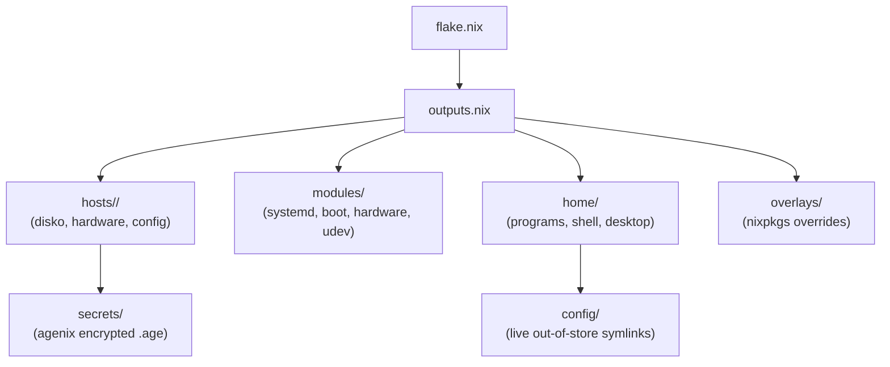

This repository manages a fleet of declarative NixOS machines and user environments using Nix flakes, centralized module abstractions, and out-of-store dotfile symlinks.

---

## High-Level Architecture

The repository separates system-level privileges from user-space configurations and keeps host-specific hardware details decoupled from generic feature modules:



---

## Repository Layout

```text
nix-config/
├── flake.nix                   # Flake input definitions and lockfile reference
├── outputs.nix                 # Centralized host definitions and module pipeline
├── adopt.sh                    # Automated adoption and profile scaffolding
│
├── hosts/                      # Host-specific hardware and partition definitions
│   ├── framework16/            # Framework Laptop 16 (Ryzen 7040, LUKS, Secure Boot)
│   ├── mini-pc-k8/             # GMKtec K8 Plus Mini PC (Ryzen 8845HS HTPC)
│   └── installer/              # Custom live ISO host and flake apps (install-nixos)
│
├── modules/                    # Reusable NixOS system modules
│   ├── core/                   # Baseline system configuration (boot, network, security, packages)
│   ├── laptop/                 # Portable device power management and lid handling
│   ├── desktop/                # Workstation capabilities and shared desktop services
│   ├── hyprland/               # Hyprland compositor, UWSM session, Ly greeter
│   ├── sunshine/               # Sunshine desktop streaming and automated tablet virtual display
│   ├── shell-scripts/          # Custom CLI utilities packaged via writeShellApplication
│   └── ...                     # AI, gaming, power management, VPN, wireless, secrets
│
├── home/                       # Pure user-space Home Manager modules
│   ├── browsers/               # Web browsers (Zen Browser, Helium)
│   ├── cli/                    # CLI tools (bat, btop, eza, fzf, git, yazi, zoxide, antigravity)
│   ├── desktop/                # Noctalia desktop shell (bar, OSD, lockscreen, runner)
│   ├── editors/                # NixVim (declarative Neovim) and Zed
│   ├── media/                  # Desktop media clients (Feishin, Jellyfin, mpv)
│   ├── shell/                  # Fish shell, interactive prompts, and aliases
│   ├── social/                 # Messaging clients (Vesktop)
│   └── misc/dotfile.nix        # Out-of-store symlink engine for ~/.config/
│
├── config/                     # Raw, fast-iterating dotfiles (Lua, Conf, TOML)
│   ├── hypr/                   # Hyprland Lua scripts and keybindings
│   ├── kitty/                  # Terminal configuration and session templates
│   └── starship/               # Cross-shell prompt themes
│
├── docs/                       # Starlight documentation website (hosted on GitHub Pages)
├── secrets/                    # Agenix encrypted secret vaults
│   ├── keys.nix                # Public SSH keys (single source of truth)
│   └── secrets.nix             # Encryption rules and recipient mappings
│
├── treefmt/                    # Multi-language formatter configuration (bash, lua, nix, toml)
└── overlays/                   # Nixpkgs package overrides and custom derivations
```

---

## Centralized `outputs.nix`

Rather than defining repetitive `nixosSystem` boilerplate inside `flake.nix`, all machines are declared in a centralized `hosts` attribute set within `outputs.nix`:

```nix
# outputs.nix
hosts = {
  framework16 = {
    username = "fw16-kyle";

    extraModules = [
      inputs.nixos-hardware.nixosModules.framework-16-7040-amd
      inputs.lanzaboote.nixosModules.lanzaboote

      ./modules/hardware/framework.nix
      ./modules/laptop
      ./modules/lanzaboote
    ];
  };

  mini-pc-k8 = {
    username = "k8-kyle";

    extraModules = [
      inputs.nixos-hardware.nixosModules.common-cpu-amd
      inputs.nixos-hardware.nixosModules.common-cpu-amd-pstate
      inputs.nixos-hardware.nixosModules.common-gpu-amd
      inputs.nixos-hardware.nixosModules.common-pc-ssd

      ./modules/desktop
      ./modules/power-management/ppd.nix
    ];
  };
};
```

### Automatic Module Injection
For every host defined in `hosts`, `outputs.nix` automatically injects:
1. **Core System Modules**: Disko, Stylix, Agenix, and `./modules/core`.
2. **Common Ecosystem Modules**: Gaming, Home Manager, Hyprland, Input Method, Secrets, Shell Scripts, Sunshine, VPN, and Wireless.
3. **Home Manager**: Binds Home Manager to the host's specified `username`, imports `./home` (unified user applications and dotfiles), and auto-imports `./hosts/<hostname>/home/` if present.
4. **Overlays**: Injects top-level package overlays from `./overlays`.
5. **Host Specifics**: Imports `./hosts/<hostname>` alongside any host-specific `extraModules`.
