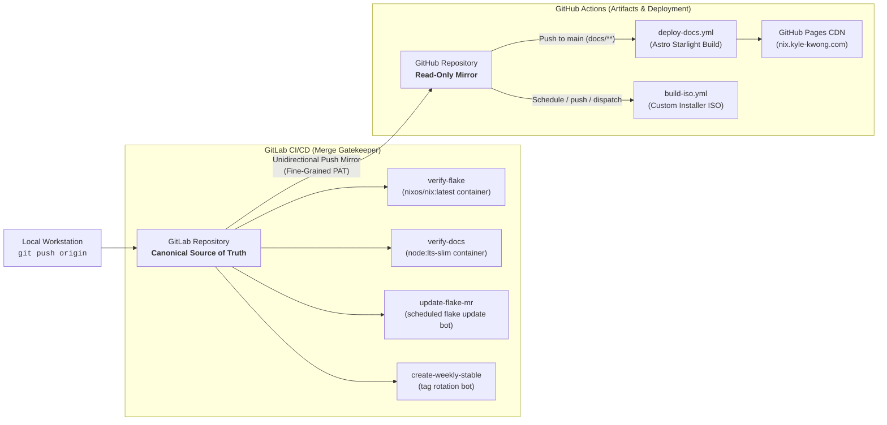
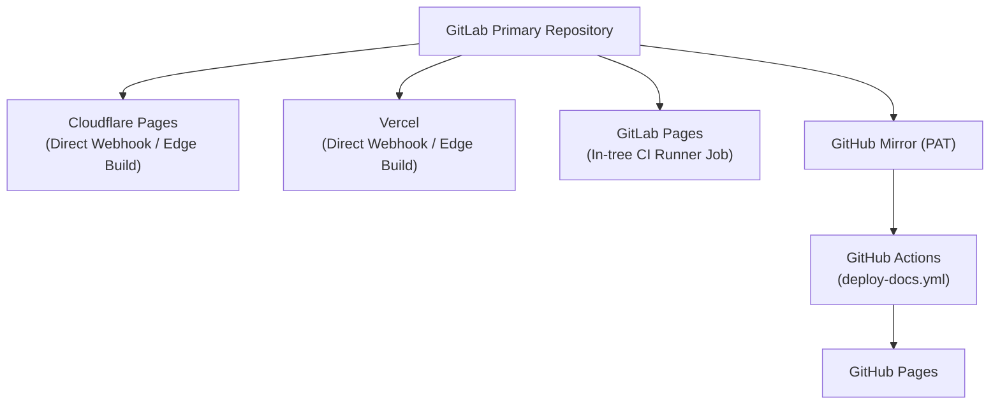

This document details the architectural and operational motivations behind the **split CI architecture** employed by `nix-config`.

The single biggest driving factor behind this design is **reliability and merge availability**: GitHub Actions experiences frequent service degradations and outages. When branch protections require GitHub Action checks to pass before merging, any GitHub Actions incident brings development to a grinding halt—blocking emergency system fixes, host configurations, and routine maintenance.

By decoupling **system evaluation, fleet maintenance, and merge gatekeeping** onto GitLab CI, merges are never blocked by GitHub downtime. GitHub Actions is relegated strictly to the non-critical role of building and deploying the static documentation to GitHub Pages.

---

## 1. High-Level Architecture

The repository enforces a strict unidirectional flow where GitLab serves as the canonical source of truth and GitHub operates purely as a read-only mirror and documentation builder:



---

## 2. Core Motivations & Rationale

### A. Merge Availability & Uptime: Escaping GitHub Actions Outages

In a declarative multi-host NixOS fleet, rapid deployment and unblocked iteration are essential. When an urgent hardware fix or configuration tweak needs to be deployed, developers cannot afford to be blocked by CI downtime.

On GitHub, repository branch protections typically require CI status checks to pass before merging a pull request. However, GitHub Actions frequently suffers from:
- Runner queue stalls and degraded performance during peak hours.
- Infrastructure-wide Actions outages where jobs fail to schedule or complete.
- Webhook delivery delays and API degradation.

When GitHub Actions is down, pull requests are frozen in an unmergeable state. In contrast, GitLab CI offers significantly higher uptime and reliable job execution. By using GitLab CI as the authoritative gatekeeper for Merge Requests:
- **Zero Merge Blockers**: Code can always be evaluated, validated, and merged into `main` without waiting on GitHub infrastructure.
- **Fail-Safe Docs Deployment**: GitHub Actions is restricted solely to `.github/workflows/deploy-docs.yml`. If GitHub Actions goes down, it only temporarily delays static documentation deployment—core fleet evaluation, merges, and system rebuilds remain 100% operational. The documentation build simply catches up whenever GitHub recovers.

### B. Containerized Determinism & Pure Nix Isolation

GitLab CI jobs execute directly inside pristine, official OCI container images:
- **`nixos/nix:latest`**: Runs `nix fmt` verification and `nix flake check` in an unadulterated Nix environment.
- **`node:lts-slim`**: Verifies that Astro Starlight documentation builds cleanly without pulling extraneous build tools.

In contrast to cloud VM runners that execute multi-step setup scripts on shared host environments, GitLab CI spins up fresh container instances for each job. Combined with GitLab's `FF_USE_FASTZIP` caching (`.cache/nix` keyed on `flake.lock` and `.cache/npm` keyed on `docs/package-lock.json`), builds remain completely reproducible, isolated, and fast.

### C. Eliminating GitHub Actions Supply-Chain & Deprecation Churn

Standard Nix continuous integration workflows on GitHub Actions typically rely on a deep chain of third-party composite actions (such as `actions/checkout`, `determinate-nix-action`, `cachix/install-nix-action`, or `magic-nix-cache`). While convenient, this model introduces distinct maintenance liabilities:

1. **Supply-Chain Attack Surface**: Composite actions run arbitrary JavaScript and third-party binary installers with ambient runner access.
2. **Node Runtime Deprecation Churn**: GitHub Actions periodically deprecates Node runtime versions (Node 12 &rarr; Node 16 &rarr; Node 20 &rarr; Node 22). Workflows and pinned composite action tags must be continuously audited and bumped across repositories to avoid runner deprecation failures.
3. **Marketplace Outages & Rate Limits**: Relying on external action repositories subjects core flake evaluation to GitHub Marketplace outages, action repository deletions, and runner API rate limits.

On GitLab CI, jobs execute standard POSIX shell scripts directly inside official container images. There are **zero external JavaScript action dependencies**, completely eliminating runtime deprecation cycles and third-party supply-chain vectors for core fleet validation.

### D. Native Bot Automation via Git Push Options

Automating `flake.lock` updates and weekly release tags is a critical maintenance task for a rolling NixOS fleet. On GitHub, running automated update bots typically requires:
- Personal Access Tokens (PATs) with expansive repo permissions to bypass branch protections.
- Third-party bots or GitHub Apps (e.g. Renovate, Dependabot).
- Complex workflow files orchestrating pull request creation and auto-merge approvals.

GitLab CI natively eliminates this complexity through **Git Push Options** and built-in **`CI_JOB_TOKEN`** credentials:

```bash
# Push update branch and automatically generate a configured Merge Request
git push -f origin "$BRANCH_NAME" \
  -o merge_request.create \
  -o merge_request.target="$CI_DEFAULT_BRANCH" \
  -o merge_request.title="chore(flake): update flake.lock ($(date +%Y-%m-%d))" \
  -o merge_request.description="The following flake inputs were updated:\n$SUMMARY" \
  -o merge_request.remove_source_branch \
  -o merge_request.label="dependencies" \
  -o merge_request.assignee_id="$GITLAB_USER_ID" \
  -o merge_request.squash=true \
  -o merge_request.merge_when_pipeline_succeeds
```

Using pure `git push` options:
- No personal access token is stored or exposed in CI environment variables.
- The pipeline authenticates using GitLab's short-lived, job-scoped `CI_JOB_TOKEN`.
- The Merge Request is automatically created, formatted with the exact `nix flake update` summary, assigned to the repository owner, and queued to merge automatically once `verify-flake` passes.
- Tag rotation (`create-weekly-stable`) tags the commit and purges tags older than 12 weeks using native git commands in an Alpine container.

### E. Zero-Cost Edge CDN for Documentation

While GitLab excels at isolated container pipelines and native git bot workflows, GitHub Pages provides an outstanding, zero-maintenance global edge CDN:
- Globally distributed edge caching with fast response times.
- Automated Let's Encrypt TLS certificate provisioning and renewal for custom apex/subdomains (`nix.kyle-kwong.com`).
- Broad discoverability within the open-source ecosystem.

Restricting GitHub Actions to [`.github/workflows/deploy-docs.yml`](https://gitlab.com/kylekwong/nix-config/-/blob/main/.github/workflows/deploy-docs.yml) and [`.github/workflows/build-iso.yml`](https://gitlab.com/kylekwong/nix-config/-/blob/main/.github/workflows/build-iso.yml) confines GitHub runner execution strictly to non-critical static site generation and automated installer ISO artifact releases.

### F. Blast Radius Containment & Defense-in-Depth

The split architecture strictly contains operational blast radiuses:
- **Outage Immunity**: If GitHub experiences an outage, degraded runner queues, or service disruption, core NixOS fleet maintenance, MR validation, local machine rebuilds, and flake updates continue without interruption on GitLab.
- **Documentation Build Isolation**: If an Astro dependency or Starlight build failure occurs in GitHub Actions, it has zero impact on NixOS system builds or merge pipelines on GitLab.
- **Least-Privilege Token Scoping**: The GitLab push mirror authenticates to GitHub using a **fine-grained personal access token** scoped exclusively to `Contents: Read and write` on the `nix-config` mirror repository. If the mirror token were ever compromised, it grants zero access to other repositories, user profile settings, or organization assets.

---

## 3. Comparison Matrix: GitLab CI vs. GitHub Actions

| Evaluation Vector | GitLab CI (Fleet Validation & Merges) | GitHub Actions (Docs & Artifact Releases) |
| :--- | :--- | :--- |
| **Outage Impact on Merges** | **Zero Impact**: Highly reliable runners; merges proceed normally | **Zero Impact**: Outages only delay wiki CDN updates or installer ISO releases; never blocks merges |
| **Primary Responsibility** | `nix flake check`, `nix fmt`, lock updates, release tags | Building & publishing Astro Starlight wiki to Pages and releasing custom installer ISOs |
| **Execution Model** | Native OCI containers (`nixos/nix`, `node:lts-slim`) | Shared Ubuntu VM runners (`ubuntu-latest`) |
| **Dependency Model** | Raw bash scripts inside container images | Composite actions (`actions/checkout`, `withastro/action`) |
| **Action Churn** | None (no external marketplace actions) | Periodic Node runtime upgrades & action bumps |
| **Automated MR / PR Creation** | Native Git Push Options via `CI_JOB_TOKEN` | Requires Personal Access Token or GitHub App |
| **State / Authority** | Canonical source of truth (read/write) | Downstream mirror (strictly read-only) |

---

## 4. Repository Synchronization & Operational Hygiene

To maintain stability across both forges, follow these operational rules:

### 1. Single Authoritative Remote
All development branches, pull/merge requests, and commits must be pushed directly to GitLab:

```bash
git remote set-url origin git@gitlab.com:<username>/nix-config.git
```

### 2. Unidirectional Push Mirroring
GitLab's repository mirroring feature automatically pushes all branch updates and tags to GitHub over HTTPS using the fine-grained PAT. Never push directly to GitHub; doing so causes divergent git histories and breaks automatic mirroring.

### 3. Read-Only Mirror Banner
Mark the GitHub repository description as a read-only mirror pointing back to your GitLab canonical repository:

```text
[Read-Only Mirror] Primary development on GitLab: https://gitlab.com/<username>/nix-config
```

### 4. GitHub Actions Repository Permissions
To allow the automated installer ISO release workflow ([`.github/workflows/build-iso.yml`](https://gitlab.com/kylekwong/nix-config/-/blob/main/.github/workflows/build-iso.yml)) to compile and publish releases and the documentation workflow ([`.github/workflows/deploy-docs.yml`](https://gitlab.com/kylekwong/nix-config/-/blob/main/.github/workflows/deploy-docs.yml)) to deploy to Pages on the GitHub mirror or fork:
- **Actions Execution Policy**: In GitHub repository **Settings** → **Actions** → **General** → **Actions permissions**, select **"Allow select actions and reusable workflows"**, check **"Allow actions created by GitHub"**, and configure the explicit pattern allowlist:
  ```text
  cachix/*,
  pnpm/*,
  softprops/*,
  withastro/*,
  ```
- **Workflow Permissions**: Under **Workflow permissions**, select **Read and write permissions** (required for creating/updating releases, tagging `installer`, and uploading release binaries via `softprops/action-gh-release`) and check **Allow GitHub Actions to create and approve pull requests**.
- **Pages Source**: In **Settings** → **Pages** → **Build and deployment** → **Source**, select **GitHub Actions** (enables automatic OIDC token provisioning with `pages: write` and `id-token: write` for `actions/deploy-pages`).
- **Fork Enablement**: If the downstream repository is a fork, navigate to the **Actions** tab and click **"I understand my workflows, go ahead and enable them"** (Actions are disabled by default on newly created forks).

---

## 5. Alternatives to GitHub Actions for Wiki Hosting

While this repository uses GitHub Actions to deploy static documentation to GitHub Pages, future users and adopters should strongly consider modern edge hosting alternatives—particularly **Cloudflare Pages** and **Vercel**.

These platforms connect natively to either **GitLab** or **GitHub**, completely bypassing the need for GitHub Actions runners and eliminating documentation deployment failures caused by GitHub Actions outages.



### Modern Edge Platform Comparison

| Platform | Git Source | Build Trigger | Bandwidth / Limits | Key Benefits |
| :--- | :--- | :--- | :--- | :--- |
| **Cloudflare Pages** | GitLab or GitHub | Native Git Webhook | Unlimited bandwidth, 500 builds/mo (free) | Global Anycast edge, zero runner setup, connects directly to GitLab without needing a GitHub mirror |
| **Vercel** | GitLab or GitHub | Native Git Webhook | 100 GB bandwidth (free hobby tier) | Instant preview deployments on MRs/PRs, zero-config Astro detection |
| **GitLab Pages** | GitLab | `.gitlab-ci.yml` `pages` job | Bound to GitLab CI pipeline minutes | Fully self-contained within GitLab; requires no third-party accounts or external webhooks |
| **GitHub Pages** | GitHub | GitHub Actions (`deploy-docs.yml`) | 100 GB/mo; subject to Action runner health | Native within GitHub; vulnerable to GitHub Actions runner outages and queue delays |

---

### Recommended Setup: Cloudflare Pages

Cloudflare Pages provides arguably the best alternative for adopters hosting their primary repository on GitLab who do not wish to maintain a GitHub push mirror just for static site hosting.

#### Build Configuration Settings:
- **Framework preset**: `Astro`
- **Root directory**: `docs`
- **Build command**: `npm run build`
- **Build output directory**: `dist`
- **Environment variables**:
  - `NODE_VERSION`: `22`

> [!TIP]
> Connecting Cloudflare Pages directly to your GitLab repository allows you to receive instant documentation builds and pull request preview URLs on GitLab without ever touching GitHub or generating personal access tokens.

---

### Recommended Setup: Vercel

Vercel provides native Astro support and instant preview URLs for both GitLab Merge Requests and GitHub Pull Requests.

#### Build Configuration Settings:
- **Framework preset**: `Astro`
- **Root Directory**: `docs`
- **Build Command**: `npm run build`
- **Output Directory**: `dist`
- **Node.js Version**: `22.x` (configured under **Project Settings** &rarr; **General**)

---

## 6. Adopting or Modifying the CI Model

If you are adopting or forking this repository, choose the deployment and CI topology that best matches your workflow:

1. **Split CI (GitLab Primary + GitHub Pages)**:
   Keep the default architecture documented in this guide. Follow the token generation and push-mirroring instructions in [Adoption: Reproducing Split CI](/adoption/#5-continuous-integration--the-split-ci-architecture).

2. **GitLab Primary + Cloudflare Pages / Vercel (Recommended Modern Alternative)**:
   Connect your GitLab repository directly to Cloudflare Pages or Vercel with the build settings listed above. This eliminates the GitHub mirror, GitHub Actions workflows, and PAT maintenance while preserving GitLab CI's rock-solid merge gatekeeping.

3. **Consolidate on GitLab (GitLab CI + GitLab Pages)**:
   Delete `.github/` and add a `pages` job to `.gitlab-ci.yml` using `node:lts-slim` to build and serve the wiki directly through GitLab Pages.

4. **Consolidate on GitHub (GitHub Actions Only)**:
   Delete `.gitlab-ci.yml`, set up `determinate-nix-action` for pull request checks, and deploy to GitHub Pages. Be aware that GitHub Actions outages can block pull request merges under branch protection rules.

See the [Adoption & Forking Guide](/adoption/#alternative-single-forge-workflows) for step-by-step instructions and sample configurations.
