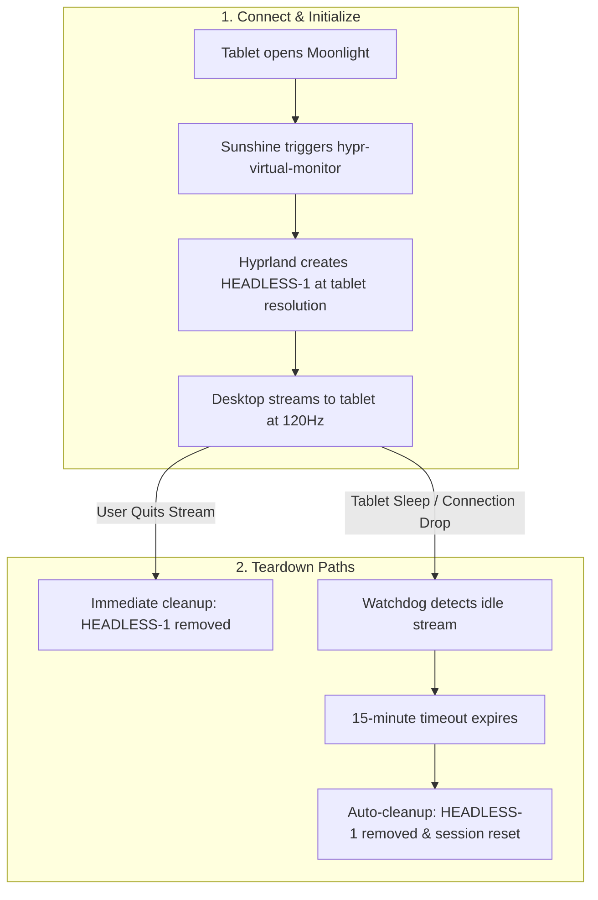

Provides a self-hosted [Sunshine](https://github.com/LizardByte/Sunshine) game and desktop streaming server for use with [Moonlight](https://moonlight-stream.org/) clients (such as Android tablets, phones, handheld consoles, or secondary PCs).

---

## Capabilities & Architecture

- **Hardware-Accelerated Encoding**: Automatically leverages GPU hardware encoding (VA-API on AMD Radeon GPUs) for ultra-low latency, high-framerate streaming (up to 120 FPS / 4K / HDR).
- **Direct Wayland Capture (`capture = wlr`)**: Configured to use `wlr-screencopy-unstable-v1` DMA-BUF capture directly with Hyprland. Bypasses XDG Desktop Portal screencast prompts, preventing interactive `hyprland-share-picker` dialogs from appearing upon systemd user service startup.
- **Default-Enabled Across Fleet**: Registered in common system modules (`outputs.nix`) and enabled by default (`custom.sunshine.enable = true`).
- **Autostart Control**: Runs automatically upon graphical login (`custom.sunshine.autoStart = true`). Can be toggled to `false` per-host if on-demand startup is preferred.
- **Firewall Integration**: Automatically provisions open TCP (`47984, 47989, 47990, 48010`) and UDP (`47998-48000, 48002, 48010`) ports.
- **Input Emulation & Permissions**: Configures `uinput` rules, grants `video` and `input` permissions, and assigns `cap_sys_admin+p` capabilities to the Sunshine binary.
- **Opt-Out Toggle**: Can be disabled per-host in `hosts/<hostname>/config.nix`:
  ```nix
  custom.sunshine.enable = false;
  ```

---

## Zero-Touch Tablet Extended Display

When `custom.sunshine.tabletDisplay.enable = true` (default), the module provides an automated, zero-touch virtual second display for tablets:



### 1. Connection Lifecycle
1. **Initiate Stream from Tablet**:
   - Open Moonlight on the tablet and tap **Tablet Display**.
   - Sunshine executes the `prep-cmd` hook: `/run/current-system/sw/bin/hypr-virtual-monitor start HEADLESS-1 <scale>`.
   - The script dynamically reads Moonlight's negotiated resolution and refresh rate (`SUNSHINE_CLIENT_WIDTH`, `SUNSHINE_CLIENT_HEIGHT`, `SUNSHINE_CLIENT_FPS`) and creates a virtual headless monitor (`HEADLESS-1`) in Hyprland with exact 1:1 pixel dimensions and 120Hz refresh rate.
   - Windows and workspaces placed on `HEADLESS-1` stream directly to the tablet screen.

2. **Graceful Teardown**:
   - Exiting the stream or tapping **Quit Session** in Moonlight triggers the `prep-cmd` `undo` action: `hypr-virtual-monitor stop HEADLESS-1`.
   - Hyprland removes `HEADLESS-1` and automatically returns active workspaces to your primary monitor.

3. **On-Demand Idle Watchdog (15-Minute Timeout)**:
   - Sunshine treats client disconnects (or tablet screen locks) as "paused" sessions to allow game reconnection, leaving `HEADLESS-1` open in Hyprland.
   - An on-demand systemd service (`sunshine-watchdog.service`) is launched by `hypr-virtual-monitor start` and stopped on explicit quit.
   - The watchdog periodically polls active Sunshine streaming sockets (`:47989`, `:48010`) using `ss`.
   - If the stream remains paused or disconnected continuously for **15 minutes** (`custom.sunshine.tabletDisplay.idleTimeout = 900`), the watchdog automatically destroys `HEADLESS-1` and restarts Sunshine to drop stale sessions. Zero background polling occurs when not streaming.

### 4. Manual Virtual Monitor CLI (`hypr-virtual-monitor`)
While Moonlight connections automatically provision and tear down `HEADLESS-1` via hooks, you can also control virtual displays manually:

```bash
# Toggle headless monitor on/off
hypr-virtual-monitor toggle

# Explicitly create or remove a virtual monitor
hypr-virtual-monitor start HEADLESS-1
hypr-virtual-monitor stop HEADLESS-1
```

---

## USB Tethering (Zero-Latency / Offline Mode)

To stream with sub-millisecond latency (<0.5ms) and eliminate Wi-Fi jitter completely:

1. Connect the tablet to the PC via a USB-C cable.
2. Enable **USB Tethering** in Android settings.
3. NetworkManager automatically assigns an IP address on the tethered interface (`usb*` or `en*u*`).
4. In Moonlight, connect to the PC's USB IP (or mDNS hostname `<hostname>.local`, e.g. `mini-pc-k8.local` or `framework16.local`).
5. **Gateway Protection**: The module configures NetworkManager with `ipv4.never-default = true` and `ipv4.route-metric = 1000` for all USB tethering interfaces, guaranteeing that the tablet never overrides the PC's primary internet routing.

---

## Initial Setup & Pairing

1. **Access Web Configuration**: Open `https://localhost:47990` in your browser (accept the self-signed TLS certificate warning).
2. **Set Credentials**: On first launch, create an administrative username and password.
3. **Pair Client**:
   - Open Moonlight on your client device.
   - Tap your host machine to display a 4-digit PIN.
   - Enter the PIN in the Sunshine Web UI under the **PIN** tab.
